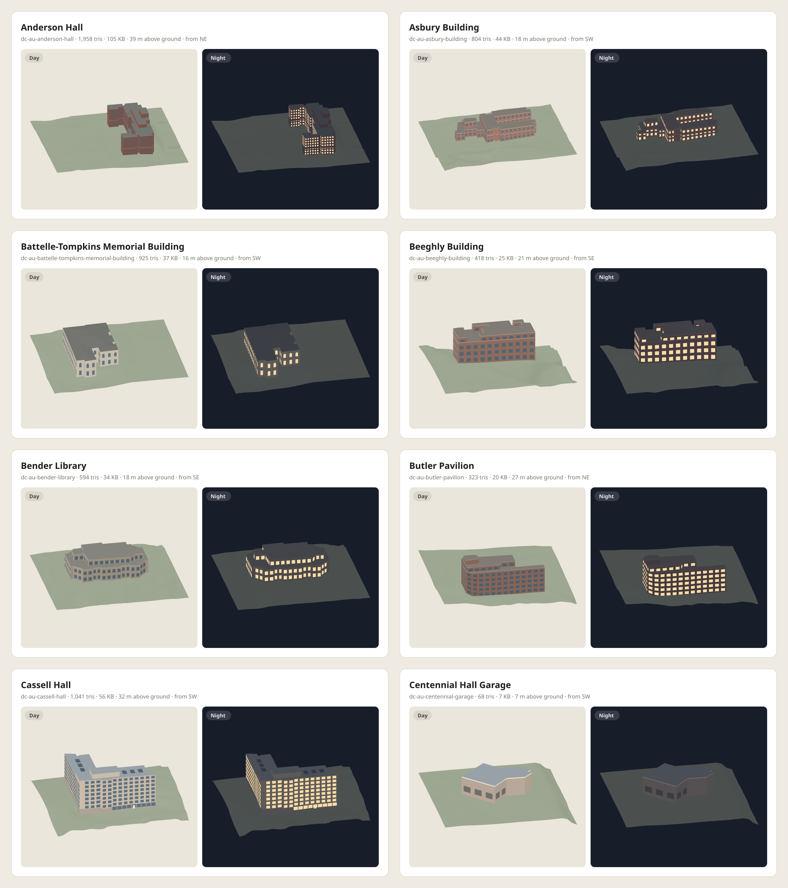
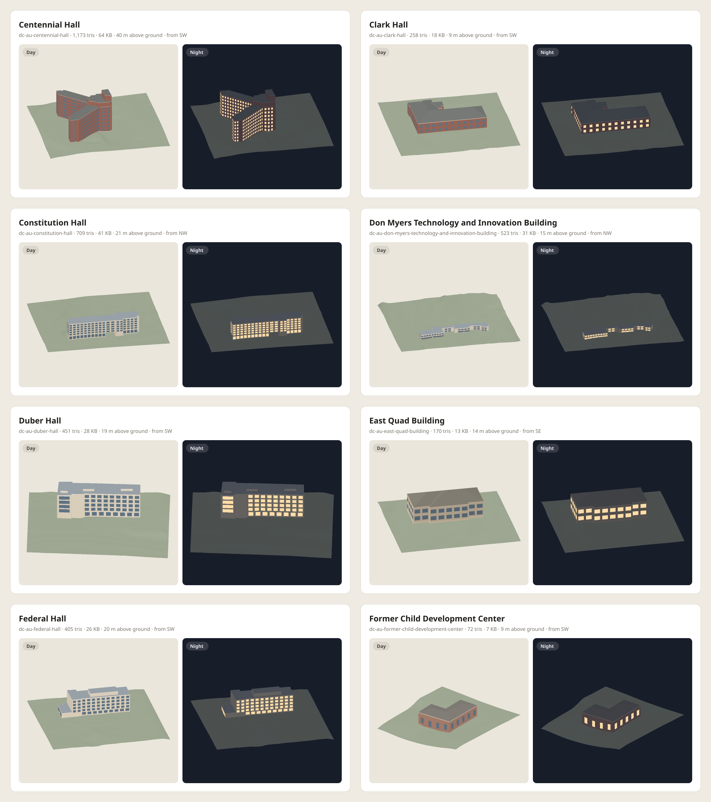
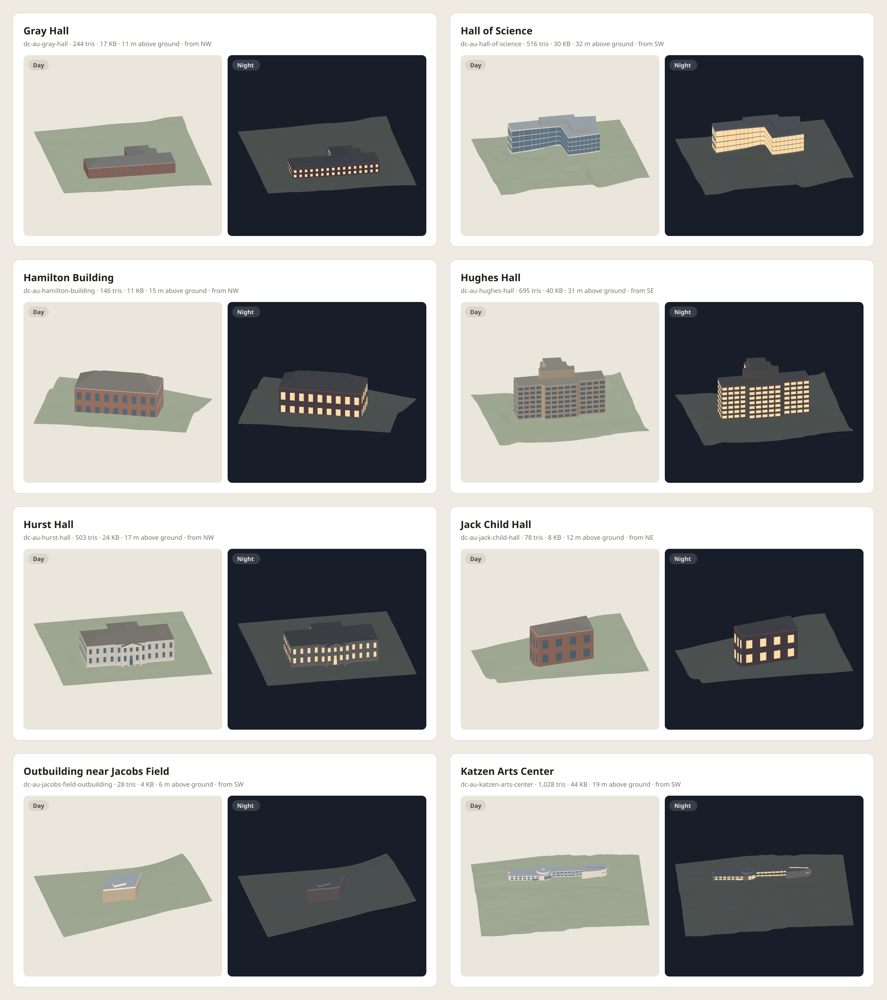
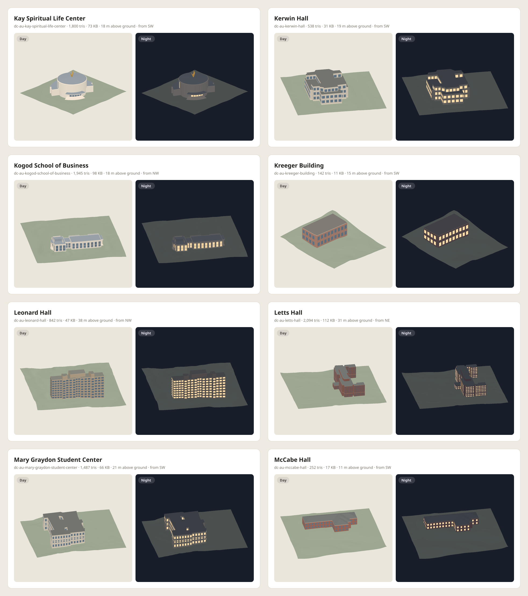
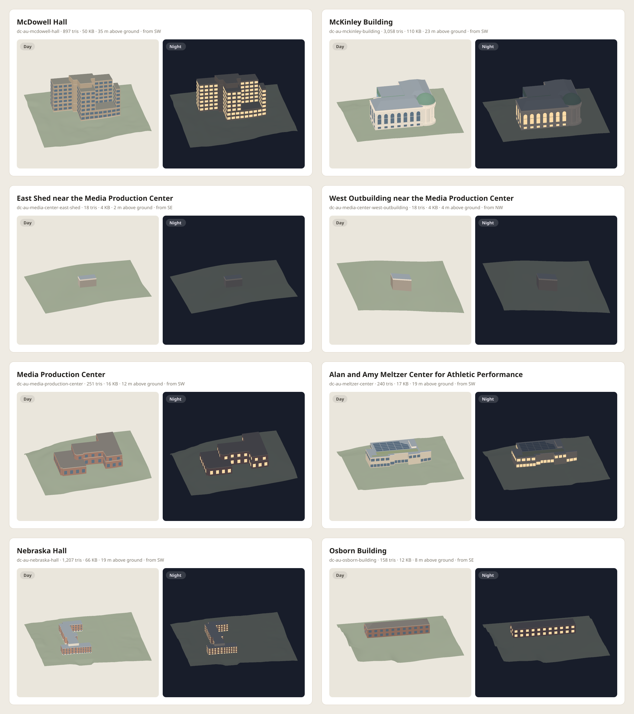
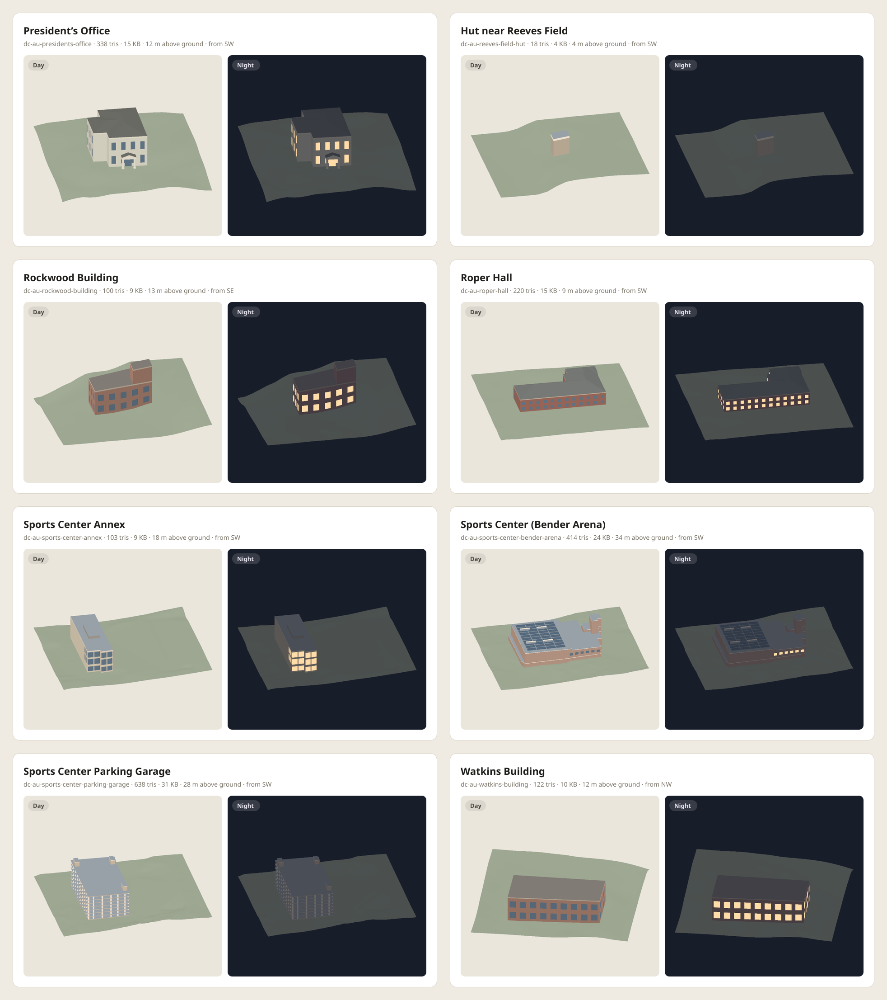

# American University · Main and East campuses

This batch adds 48 buildings in Washington, DC, including the four East Campus buildings, the Meltzer Center and rebuilt Sports Center Annex, two garages, and four small outbuildings. The School of International Service has its own submission in [PR #118](https://github.com/alexwohlbruck/landmarks/pull/118).

The six sheets show the models by day and by night on ground derived from the District’s 2022 LiDAR survey. The map’s live terrain service was unavailable during review. The placement and replacement checks use the May 22, 2026 OpenStreetMap snapshot. OpenStreetMap contributors supplied the footprints under ODbL, and each model’s catalog record links to its individual sources.

## Review notes

- All 48 models have draft status. Window spacing, material colors, and individual doors are approximate. The four ancillary structures use descriptive location names because their formal names and uses could not be confirmed.
- The Meltzer Center and the rebuilt Sports Center Annex postdate the 2022 LiDAR survey. Their footprints use the 2026 map, and their heights and façade details are estimates.
- The former Child Development Center has a mapped footprint and measured roof. The building’s current use is unconfirmed.
- The campus-boundary check excluded a mapped shed without an elevated surface in the 2022 survey and a 5.5 m² outline adjoining the Media Production Center whose roof could not be verified. The grid-based overlap check flags the latter. The projected model intersects less than 0.01 m² of it. The placement preserves the separate map feature.
- The former Reeves gazebo was excluded because its continued presence could not be verified. Playing fields and open-air recreation areas fall outside this building inventory.

[University campus map](https://www.american.edu/about/upload/campus-map.pdf) · [2022 DC LiDAR metadata](https://noaa-nos-coastal-lidar-pds.s3.amazonaws.com/laz/geoid18/9837/dc2022_wash_dc_metadata.html) · [May 2026 OSM extract](https://github.com/kameronlee/heat-aware-pedestrian-routing/blob/456fd09d67aae857907e8c2b7fa6c19332734bd5/data/raw/osm/district-of-columbia-latest.osm.pbf)

## Models

| Name | id | lat, lng | Height | Replaces | Evidence | Doubts |
|---|---|---|---|---|---|---|
| Anderson Hall | `dc-au-anderson-hall` | [38.93590, -77.09083](https://www.openstreetmap.org/#map=18/38.93590/-77.09083) | 36 m | 1 | 2026 OSM plan and 2022 DC LiDAR | Façade openings and finish colors are approximate. |
| Asbury Building | `dc-au-asbury-building` | [38.93719, -77.09030](https://www.openstreetmap.org/#map=18/38.93719/-77.09030) | 13 m | 1 | 2026 OSM plan and 2022 DC LiDAR | Façade openings and finish colors are approximate. |
| Battelle-Tompkins Memorial Building | `dc-au-battelle-tompkins-memorial-building` | [38.93745, -77.08841](https://www.openstreetmap.org/#map=18/38.93745/-77.08841) | 14 m | 1 | 2026 OSM plan and 2022 DC LiDAR | Façade openings and finish colors are approximate. |
| Beeghly Building | `dc-au-beeghly-building` | [38.93684, -77.09144](https://www.openstreetmap.org/#map=18/38.93684/-77.09144) | 18 m | 1 | 2026 OSM plan and 2022 DC LiDAR | Façade openings and finish colors are approximate. |
| Bender Library | `dc-au-bender-library` | [38.93597, -77.08894](https://www.openstreetmap.org/#map=18/38.93597/-77.08894) | 18 m | 1 | 2026 OSM plan and 2022 DC LiDAR | Façade openings and finish colors are approximate. |
| Butler Pavilion | `dc-au-butler-pavilion` | [38.93750, -77.08908](https://www.openstreetmap.org/#map=18/38.93750/-77.08908) | 26 m | 1 | 2026 OSM plan and 2022 DC LiDAR | Façade openings and finish colors are approximate. |
| Cassell Hall | `dc-au-cassell-hall` | [38.93930, -77.08896](https://www.openstreetmap.org/#map=18/38.93930/-77.08896) | 28 m | 1 | 2026 OSM plan and 2022 DC LiDAR | Façade openings and finish colors are approximate. |
| Centennial Hall Garage | `dc-au-centennial-garage` | [38.93616, -77.09131](https://www.openstreetmap.org/#map=18/38.93616/-77.09131) | 7 m | 1 | 2026 OSM plan and 2022 DC LiDAR | Façade openings and finish colors are approximate. |
| Centennial Hall | `dc-au-centennial-hall` | [38.93611, -77.09121](https://www.openstreetmap.org/#map=18/38.93611/-77.09121) | 37 m | 1 | 2026 OSM plan and 2022 DC LiDAR | Façade openings and finish colors are approximate. |
| Clark Hall | `dc-au-clark-hall` | [38.93547, -77.08942](https://www.openstreetmap.org/#map=18/38.93547/-77.08942) | 9 m | 1 | 2026 OSM plan and 2022 DC LiDAR | Façade openings and finish colors are approximate. |
| Constitution Hall | `dc-au-constitution-hall` | [38.93650, -77.08661](https://www.openstreetmap.org/#map=18/38.93650/-77.08661) | 20 m | 1 | 2026 OSM plan and 2022 DC LiDAR | Façade openings and finish colors are approximate. |
| Don Myers Technology and Innovation Building | `dc-au-don-myers-technology-and-innovation-building` | [38.93583, -77.08610](https://www.openstreetmap.org/#map=18/38.93583/-77.08610) | 11 m | 1 | 2026 OSM plan and 2022 DC LiDAR | Façade openings and finish colors are approximate. |
| Duber Hall | `dc-au-duber-hall` | [38.93557, -77.08669](https://www.openstreetmap.org/#map=18/38.93557/-77.08669) | 18 m | 1 | 2026 OSM plan and 2022 DC LiDAR | Façade openings and finish colors are approximate. |
| East Quad Building | `dc-au-east-quad-building` | [38.93633, -77.08800](https://www.openstreetmap.org/#map=18/38.93633/-77.08800) | 13 m | 1 | 2026 OSM plan and 2022 DC LiDAR | Façade openings and finish colors are approximate. |
| Federal Hall | `dc-au-federal-hall` | [38.93604, -77.08632](https://www.openstreetmap.org/#map=18/38.93604/-77.08632) | 20 m | 1 | 2026 OSM plan and 2022 DC LiDAR | Façade openings and finish colors are approximate. |
| Former Child Development Center | `dc-au-former-child-development-center` | [38.93567, -77.09183](https://www.openstreetmap.org/#map=18/38.93567/-77.09183) | 6 m | 1 | 2026 OSM plan and 2022 DC LiDAR | The former program closed in 2024. Present use unconfirmed. |
| Gray Hall | `dc-au-gray-hall` | [38.93496, -77.08935](https://www.openstreetmap.org/#map=18/38.93496/-77.08935) | 10 m | 1 | 2026 OSM plan and 2022 DC LiDAR | Façade openings and finish colors are approximate. |
| Hall of Science | `dc-au-hall-of-science` | [38.93681, -77.09059](https://www.openstreetmap.org/#map=18/38.93681/-77.09059) | 26 m | 1 | 2026 OSM plan and 2022 DC LiDAR | Façade openings and finish colors are approximate. |
| Hamilton Building | `dc-au-hamilton-building` | [38.93496, -77.09172](https://www.openstreetmap.org/#map=18/38.93496/-77.09172) | 14 m | 1 | 2026 OSM plan and 2022 DC LiDAR | Façade openings and finish colors are approximate. |
| Hughes Hall | `dc-au-hughes-hall` | [38.93830, -77.08852](https://www.openstreetmap.org/#map=18/38.93830/-77.08852) | 29 m | 1 | 2026 OSM plan and 2022 DC LiDAR | Façade openings and finish colors are approximate. |
| Hurst Hall | `dc-au-hurst-hall` | [38.93687, -77.08747](https://www.openstreetmap.org/#map=18/38.93687/-77.08747) | 17 m | 1 | 2026 OSM plan and 2022 DC LiDAR | Façade openings and finish colors are approximate. |
| Jack Child Hall | `dc-au-jack-child-hall` | [38.93499, -77.09129](https://www.openstreetmap.org/#map=18/38.93499/-77.09129) | 10 m | 1 | 2026 OSM plan and 2022 DC LiDAR | Façade openings and finish colors are approximate. |
| Outbuilding near Jacobs Field | `dc-au-jacobs-field-outbuilding` | [38.93544, -77.09255](https://www.openstreetmap.org/#map=18/38.93544/-77.09255) | 4 m | 1 | 2026 OSM plan and 2022 DC LiDAR | Descriptive location name. Specific use and exterior finish unconfirmed. |
| Katzen Arts Center | `dc-au-katzen-arts-center` | [38.93920, -77.08696](https://www.openstreetmap.org/#map=18/38.93920/-77.08696) | 17 m | 1 | 2026 OSM plan and 2022 DC LiDAR | Façade openings and finish colors are approximate. |
| Kay Spiritual Life Center | `dc-au-kay-spiritual-life-center` | [38.93799, -77.08722](https://www.openstreetmap.org/#map=18/38.93799/-77.08722) | 17 m | 1 | 2026 OSM plan and 2022 DC LiDAR and licensed photo references | Façade openings and finish colors are approximate. |
| Kerwin Hall | `dc-au-kerwin-hall` | [38.93745, -77.08691](https://www.openstreetmap.org/#map=18/38.93745/-77.08691) | 18 m | 1 | 2026 OSM plan and 2022 DC LiDAR | Façade openings and finish colors are approximate. |
| Kogod School of Business | `dc-au-kogod-school-of-business` | [38.93804, -77.08786](https://www.openstreetmap.org/#map=18/38.93804/-77.08786) | 16 m | 1 | 2026 OSM plan and 2022 DC LiDAR and licensed photo references | Façade openings and finish colors are approximate. |
| Kreeger Building | `dc-au-kreeger-building` | [38.93471, -77.09264](https://www.openstreetmap.org/#map=18/38.93471/-77.09264) | 11 m | 1 | 2026 OSM plan and 2022 DC LiDAR | Façade openings and finish colors are approximate. |
| Leonard Hall | `dc-au-leonard-hall` | [38.93873, -77.08955](https://www.openstreetmap.org/#map=18/38.93873/-77.08955) | 35 m | 1 | 2026 OSM plan and 2022 DC LiDAR | Façade openings and finish colors are approximate. |
| Letts Hall | `dc-au-letts-hall` | [38.93563, -77.09031](https://www.openstreetmap.org/#map=18/38.93563/-77.09031) | 29 m | 1 | 2026 OSM plan and 2022 DC LiDAR | Façade openings and finish colors are approximate. |
| Mary Graydon Student Center | `dc-au-mary-graydon-student-center` | [38.93693, -77.08895](https://www.openstreetmap.org/#map=18/38.93693/-77.08895) | 19 m | 1 | 2026 OSM plan and 2022 DC LiDAR | Façade openings and finish colors are approximate. |
| McCabe Hall | `dc-au-mccabe-hall` | [38.93507, -77.08981](https://www.openstreetmap.org/#map=18/38.93507/-77.08981) | 10 m | 1 | 2026 OSM plan and 2022 DC LiDAR | Façade openings and finish colors are approximate. |
| McDowell Hall | `dc-au-mcdowell-hall` | [38.93863, -77.08891](https://www.openstreetmap.org/#map=18/38.93863/-77.08891) | 32 m | 1 | 2026 OSM plan and 2022 DC LiDAR | Façade openings and finish colors are approximate. |
| McKinley Building | `dc-au-mckinley-building` | [38.93627, -77.08947](https://www.openstreetmap.org/#map=18/38.93627/-77.08947) | 21 m | 1 | 2026 OSM plan and 2022 DC LiDAR and licensed photo references | Façade openings and finish colors are approximate. |
| East Shed near the Media Production Center | `dc-au-media-center-east-shed` | [38.93630, -77.09195](https://www.openstreetmap.org/#map=18/38.93630/-77.09195) | 2 m | 1 | 2026 OSM plan and 2022 DC LiDAR | Descriptive location name. Specific use and exterior finish unconfirmed. |
| West Outbuilding near the Media Production Center | `dc-au-media-center-west-outbuilding` | [38.93630, -77.09216](https://www.openstreetmap.org/#map=18/38.93630/-77.09216) | 3 m | 1 | 2026 OSM plan and 2022 DC LiDAR | Descriptive location name. Specific use and exterior finish unconfirmed. |
| Media Production Center | `dc-au-media-production-center` | [38.93639, -77.09195](https://www.openstreetmap.org/#map=18/38.93639/-77.09195) | 9 m | 1 | 2026 OSM plan and 2022 DC LiDAR | Façade openings and finish colors are approximate. |
| Alan and Amy Meltzer Center for Athletic Performance | `dc-au-meltzer-center` | [38.93827, -77.09091](https://www.openstreetmap.org/#map=18/38.93827/-77.09091) | 18 m | 1 | 2026 OSM, university and athletics project references | New construction postdates LiDAR. Height and façade subdivisions are estimates. |
| Nebraska Hall | `dc-au-nebraska-hall` | [38.93936, -77.08552](https://www.openstreetmap.org/#map=18/38.93936/-77.08552) | 17 m | 1 | 2026 OSM plan and 2022 DC LiDAR | Façade openings and finish colors are approximate. |
| Osborn Building | `dc-au-osborn-building` | [38.93746, -77.09099](https://www.openstreetmap.org/#map=18/38.93746/-77.09099) | 8 m | 1 | 2026 OSM plan and 2022 DC LiDAR | Façade openings and finish colors are approximate. |
| President’s Office | `dc-au-presidents-office` | [38.93910, -77.08841](https://www.openstreetmap.org/#map=18/38.93910/-77.08841) | 10 m | 1 | 2026 OSM plan and 2022 DC LiDAR | Façade openings and finish colors are approximate. |
| Hut near Reeves Field | `dc-au-reeves-field-hut` | [38.93766, -77.09097](https://www.openstreetmap.org/#map=18/38.93766/-77.09097) | 3 m | 1 | 2026 OSM plan and 2022 DC LiDAR | Descriptive location name. Specific use and exterior finish unconfirmed. |
| Rockwood Building | `dc-au-rockwood-building` | [38.93484, -77.09069](https://www.openstreetmap.org/#map=18/38.93484/-77.09069) | 11 m | 1 | 2026 OSM plan and 2022 DC LiDAR | Façade openings and finish colors are approximate. |
| Roper Hall | `dc-au-roper-hall` | [38.93523, -77.08896](https://www.openstreetmap.org/#map=18/38.93523/-77.08896) | 9 m | 1 | 2026 OSM plan and 2022 DC LiDAR | Façade openings and finish colors are approximate. |
| Sports Center Annex | `dc-au-sports-center-annex` | [38.93799, -77.09034](https://www.openstreetmap.org/#map=18/38.93799/-77.09034) | 17 m | 1 | 2026 OSM, university and athletics project references | New construction postdates LiDAR. Height and façade subdivisions are estimates. |
| Sports Center (Bender Arena) | `dc-au-sports-center-bender-arena` | [38.93771, -77.08984](https://www.openstreetmap.org/#map=18/38.93771/-77.08984) | 31 m | 1 | 2026 OSM plan and 2022 DC LiDAR | Façade openings and finish colors are approximate. |
| Sports Center Parking Garage | `dc-au-sports-center-parking-garage` | [38.93715, -77.08938](https://www.openstreetmap.org/#map=18/38.93715/-77.08938) | 26 m | 1 | 2026 OSM plan and 2022 DC LiDAR | Façade openings and finish colors are approximate. |
| Watkins Building | `dc-au-watkins-building` | [38.93527, -77.09289](https://www.openstreetmap.org/#map=18/38.93527/-77.09289) | 10 m | 1 | 2026 OSM plan and 2022 DC LiDAR | Façade openings and finish colors are approximate. |

## Photo references

- Dual64bit. [AU McKineyHall ACC.jpeg](https://commons.wikimedia.org/wiki/File:AU_McKineyHall_ACC.jpeg)
- A2Kafir. [American University aerial photograph (2006, public domain)](https://commons.wikimedia.org/wiki/File:AUaerial.jpg)
- Herrperry123. [East Campus Residence Hall (Congressional Hall)](https://commons.wikimedia.org/wiki/File:East_Campus_Residence_Hall.jpg)
- Herrperry123. [Eric Freidheim Quadrangle.jpg](https://commons.wikimedia.org/wiki/File:Eric_Freidheim_Quadrangle.jpg)
- Ser Amantio di Nicolao. [Katzen Art Museum from Ward Circle](https://commons.wikimedia.org/wiki/File:Katzen_Art_Museum_from_Ward_Circle.jpg)
- Senordesupremo. [Kogod.JPG](https://commons.wikimedia.org/wiki/File:Kogod.JPG)
- Ser Amantio di Nicolao. [Kogod School of Business at American University.jpg](https://commons.wikimedia.org/wiki/File:Kogod_School_of_Business_at_American_University.jpg)
- Senordesupremo. [Bender Library (2006, public domain)](https://commons.wikimedia.org/wiki/File:LibraryRevamp.jpg)
- Herrperry123. [McKinley Building today.jpg](https://commons.wikimedia.org/wiki/File:McKinley_Building_today.jpg)
- Ser Amantio di Nicolao. [Outer view of the rotunda](https://commons.wikimedia.org/wiki/File:Outer_view_of_rotunda,_Katzen_Art_Museum.jpg)
- Ser Amantio di Nicolao. [Rear view of Nebraska Hall](https://commons.wikimedia.org/wiki/File:Rear_view_of_Nebraska_Hall_on_the_campus_of_American_University.jpg)
- Ser Amantio di Nicolao. [Rotunda and garage entrance from Massachusetts Avenue](https://commons.wikimedia.org/wiki/File:Rotunda_and_garage_entrance_of_Katzen_Art_Museum_from_Massachusetts_Avenue.jpg)
- Antony-22. [Tenleytown aerial photograph (2019, CC BY-SA 4.0)](https://commons.wikimedia.org/wiki/File:Tenleytown_aerial_2019.jpg)

Models by Salty Pancakes with OpenAI Codex (GPT-6).
